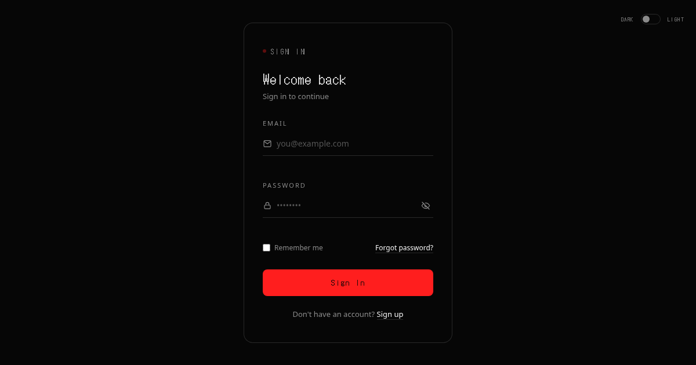

# Auth UI

> A minimal sign-in / sign-up pair with real client-side validation — monochrome, dot-matrix type, a single red accent, and a dark/light toggle.



🔗 **[View Live →](https://umairjailani.github.io/auth-ui/)**

---

## What It Does

- **Sign In** (`index.html`) and **Sign Up** (`signup.html`) — link to each other, matching design
- **Real client-side validation** — required fields, email format, password length, confirm-password match on sign up
- **Password visibility toggle** on every password field
- **Dark / light theme switch**, persisted via `localStorage`, defaults to your system preference, no flash of the wrong theme on load
- Friendly success state on submit instead of a fake redirect (there's no backend — this is a UI demo)
- No external image or icon-library dependencies — everything is CSS and inline SVG

## Tech Stack

- HTML / CSS / Vanilla JavaScript — no framework, no build step

## Run Locally

```bash
git clone https://github.com/UmairJailani/auth-ui.git
cd auth-ui
# open index.html in your browser, or use VS Code Live Server
```

---

## From Original to V2

The original was a single static login form with real, working bugs: a broken absolute CSS path, a 1.6MB unoptimized background image, an extensionless WebP file that risked breaking on static hosting, and invalid CSS. The "Register here" link didn't go anywhere.

| Original | V2 (this rebuild) |
|---|---|
| Broken absolute CSS path | Fixed, relative paths only |
| 1.6MB background image | No image assets at all — pure CSS |
| Dead "Register here" link | Real Sign Up page it actually links to |
| No validation | Full inline client-side validation |
| No password visibility toggle | Toggle on every password field |
| Single fixed theme | Dark/light toggle, persisted |
| External icon-library CDN | Inline SVG, zero extra dependencies |

---

Made by [Umair Jailani](https://github.com/UmairJailani) · Rebuilt with [Claude Code](https://claude.ai/code)
